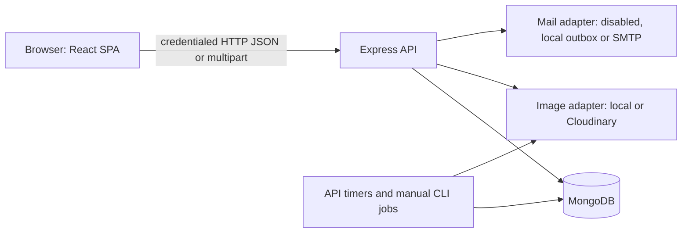

# Architecture overview

## Runtime topology

Past Perfect consists of two repositories: `Past_Perfect_Web` (React 18/Vite, browser JavaScript) and `Past_Perfect_BackEnd` (CommonJS Node.js, Express, Mongoose/MongoDB). This is a single API application with internal modules and timers, not a microservice deployment. MongoDB can run standalone: core order/inventory transitions use one document rather than replica-set transactions.

There is no websocket gateway, external message broker, separate worker service or live payment provider. API process uptime determines whether its interval jobs run. CLI commands offer manual bounded batches; they are not an installed cron service.

## Browser responsibilities

`src/App.jsx` restores the session through `GET /user/me`, chooses normal or suspended routes, and renders shared navigation. React Router's `BrowserRouter` owns client paths; hosting needs an `index.html` fallback for direct navigation. Pages handle feature state/loading/errors. `src/api.js` centralizes Axios configuration, credentialed requests, error extraction and API-relative image URLs. `VITE_API_URL` is compiled into the frontend and must never contain secrets.

Search state lives in URL parameters. Private account data is fetched from the API. Session secrets are kept in an HTTP-only cookie, not JavaScript/localStorage. The language preference is stored locally by `src/i18n.jsx`. Dynamic catalogue controls read `/catalogue`; plain user text is rendered without HTML interpretation.

## API responsibilities

| Layer | Responsibility | Examples |
| --- | --- | --- |
| `app.js` | CORS/origin policy, input size limits, static uploads, route composition and error responses | Exact mutation Origin check, 32 KB JSON body limit |
| `index.js` | Connect database before listen, start interval jobs, stop timers/server on signals | Order-expiry and search-alert sweeps |
| `middleware/` | Resolve session and apply restricted-account access | `isAuthenticated.js` |
| `routes/` | HTTP contracts, authentication/admin gates, request field allowlists | `offer.js`, `orders.js`, `reviews.js` |
| `services/` | Feature rules and persistence/provider operations | Orders, disputes, reviews, saved searches, image/mail adapters |
| `lib/` | Shared validation/configuration/policy helpers | Search parsing, typed attribute validation, catalogue and policy loading |
| `models/` | Mongoose schema/index definitions | User, Offer, Session, Enquiry, Notification |
| `scripts/` | Explicit bounded maintenance commands | Expiry, alerts, media retention/orphans |

Some route modules contain aggregation/business logic directly (for example analytics/community). The repository has modular separation, not a strict domain framework or fully abstracted repository layer.

## A typical mutation

1. Express applies the configured Origin check. A browser mutation must send the exact `WEB_ORIGIN`; CORS alone is not the authorization mechanism.
2. Authenticated routes resolve the cookie digest, session expiry and account authentication version. Suspended accounts receive a narrow permitted set of operations.
3. Owner/participant/admin checks and field/type validation run on the server. Some routes add process-local rate limits.
4. The service writes with identity/state/version predicates. A stale update normally returns 409 instead of overwriting the newer state.
5. The route returns the committed record or 204. Ordinary notification and media cleanup side effects are separate operations with documented failure/retry limits.

Neither all API calls nor all writes are idempotent. Use the [workflow guide](../workflows/marketplace.md) for safe retry behavior.

## Persistence and consistency decisions

Orders, the current reservation, each dispute and review are embedded in the listing `Offer`. An atomic update can check availability/version, append or transition the order and change the inventory lock. Order IDs address an embedded record; there is **no separate Order collection**. User saved searches and appeals are similarly embedded to enforce per-account bounds/state transitions atomically.

Messages, notifications, sessions, favourites, blocks, reports, cleanup jobs and job checkpoints have separate collections. No global transaction spans them. An enquiry can exist without a successfully written first message; an order transition can succeed while its ordinary notification fails. Search-alert delivery is a stronger special case: strict notification persistence happens before a compare-and-set cursor advance, with unique event keys for rescans.

## Assets, discovery and background work

Sharp validates/decodes images, removes metadata, rotates/resizes and writes WebP via local or Cloudinary storage. MongoDB stores references, not image binary content. Retired assets use a reference-checked cleanup queue. Retention/orphan commands default to inspection and require explicit apply; they do not purge order/account history.

Keyword discovery uses a MongoDB title/description text index with no language stemming and title weighting. Public aggregation joins eligible sellers before counting/pagination and removes private order/reservation/audit fields. Literal title and typed text attribute filters use escaped regex matching; those paths are not claimed to be indexed fuzzy search.

See [data model](data-model.md), [security](security.md), [background workflows](../workflows/moderation-and-jobs.md) and [source map](../reference/source-map.md) for implementation evidence and limits. There are no automatic prototype-data migrations or production deployment changes in this documentation set.
