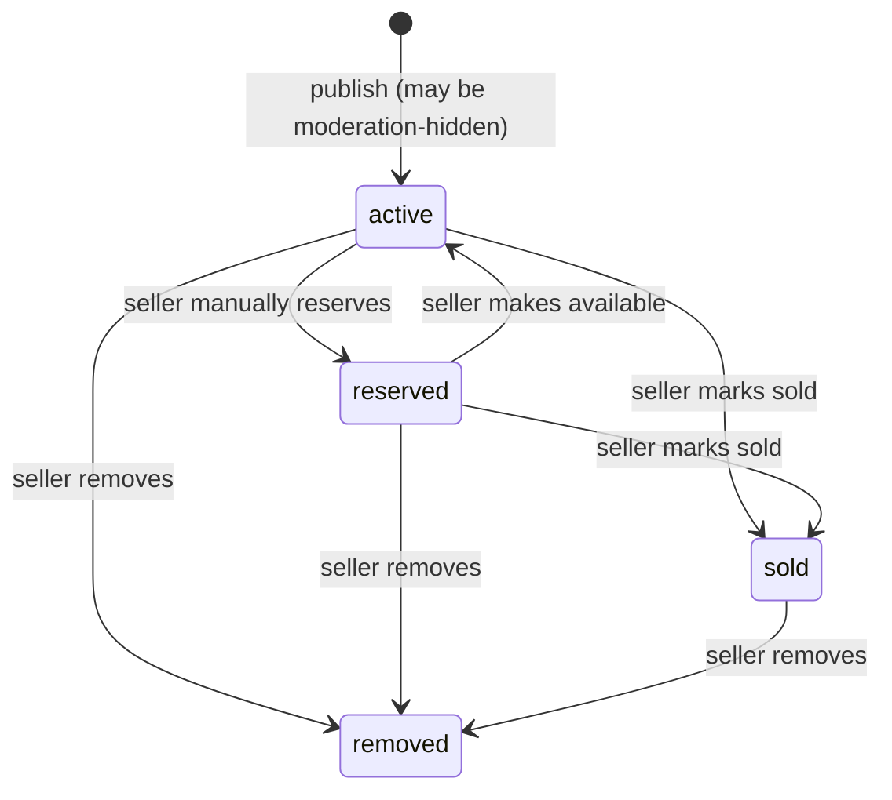
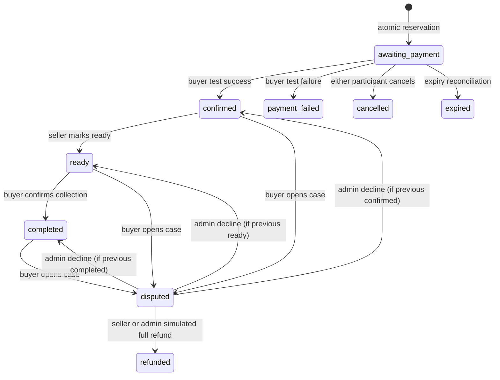

# Marketplace workflows

The rules below describe v3.0. They distinguish item availability from an order's progress. Follow [buyer](../guides/buyers.md) and [seller](../guides/sellers.md) instructions for the corresponding controls.

## 1. Discover and contact

Browse builds a URL from keyword/title, price, category/location/condition/size and typed attribute filters. The API validates them, excludes inactive/hidden listings and ineligible sellers, counts eligible matches and returns a stable-sort page. A keyword query defaults to relevance; literal title search retains substring semantics. Favourites can retain reserved/sold listings while hiding removed/hidden/suspended-owner items. Saving a favourite or a search makes no hold.

An active signed-in non-owner can start an enquiry about an active listing. The unique buyer/listing thread is reused for later messages. Each sender must be a participant; blocks in either direction or a suspended recipient prevent sending. Existing participant history survives listing sale/removal. Messages refresh manually and sending a message is not idempotent—read/refresh before retrying an ambiguous send.

## 2. Publish and manage inventory

The API validates listing fields and catalogue/policy rules, decodes and saves images, then persists the listing. A policy reject stops publication; a review match can create a hidden item pending administrator review. Stored images are compensated on failed writes where possible; crash-created orphan assets require reconciliation.

These are **manual availability transitions**, permitted only without an active buyer-order lock and subject to visibility/edit rules. Sold items cannot be edited/reactivated; hidden items cannot be edited/reactivated by owners, though removal is possible when unlocked. Soft removal hides a record; it does not delete its order/message history or immediately delete images.

## 3. Quote and reserve a test order

1. The active buyer opens **Review order** for another available seller's listing. Blocked parties and unavailable owners/items cannot start an order.
2. The API calculates `itemMinor = listing.price × 100`, configured platform fee and zero delivery, all in LKR minor units. A quote includes listing version and expected total.
3. New order creation requires verified email and enabled non-production test mode. The request carries listing ID/version, expected total and a buyer-scoped request key; supplied card/charge amounts are not accepted.
4. A single Offer update matches current availability/version, appends the immutable order snapshot, sets the item reserved, adds its matching reservation and locks owner mutation. A competing buyer receives a conflict.
5. The hold uses `ORDER_HOLD_MINUTES` (starter default 15, allowed 1–60). Cancellation by either participant, expiry or simulated payment failure releases only that matching pending hold.

The browser preserves its request key across a retry within the current checkout instance. A full reload generates a new instance: use **My orders** to recover an uncertain result. Reusing the same buyer/key with different quote expectations or another listing conflicts. This is order-creation idempotency, not universal idempotency for every action.

## 4. Simulate payment and collection

Successful simulation sets the listing sold and retains its lock until collection completion or refund. It removes the active hold deadline; the original expiry on the order snapshot is historical. The seller marks ready and the buyer confirms collection. The final confirmation unlocks a sold item, permitting later soft removal but no reactivation. Manual **Mark sold** does not create an order, establish payment or create review eligibility.

No real money moves at any step. There is no carrier/address/shipping service or automatic confirmation based on physical handover. In production, the current simulator is disabled and cannot be turned into a real provider by adding keys.

## 5. Dispute and refund

A buyer can open one case on a confirmed/ready/completed test-paid order when the simulator is enabled. The case records its previous stage, buyer reason and time; the order becomes disputed and collection actions stop. The seller may submit one response and approve a full simulated refund. An active admin can refund or decline with a resolution shared with both participants, except through admin authority on their own order.

A decline closes the case and restores the previous collection state. A simulated refund records the full original total (including any snapshotted fee), reference, actor/time and resolution. It unlocks a matching uncollected reservation but keeps the item sold, or preserves an already removed completed listing. It neither verifies return nor republishes stock. There is no partial refund, case reopening, attachment/evidence service or automatic dispute deadline. These are documented technical starter rules, not legal/customer-protection promises.

Response and admin decline can handle an existing case after simulation is disabled; new case creation and simulated refund require test mode. Suspended participants retain the permitted remedy access. Separate ordinary notifications are best-effort.

## 6. Review and inspect metrics

A completed test-order buyer can create one immutable rating (1–5) and review text. The same order revision protects creation against a concurrent dispute/moderation change. Public results require a currently completed test order, non-hidden review and eligible buyer/seller. A new dispute/refund removes eligibility without erasing the stored review; a decline returning to completed can restore it. Admin visibility moderation is independent of item visibility.

Seller analytics aggregates owned inventory/order states and simulated paid/refunded checkout totals. It does not calculate earnings, payouts, traffic or tax. See [review/alert jobs](moderation-and-jobs.md) for visibility, notifications and audit bounds.

## Retry and recovery decision table

| Situation | Appropriate response |
| --- | --- |
| 401/session expired | Sign in again; a reset or account moderation may have invalidated old sessions |
| 403 | Check account/role/block restrictions; refreshing does not grant permission |
| 404 | Target may be removed/hidden/unavailable or not owned/participant-accessible |
| 409 | Refresh latest version/state and review before retrying; do not blindly increment a version |
| Uncertain order creation | Recover through My orders; same-instance retry preserves its request key |
| Uncertain message send | Refresh thread before resending to avoid duplicate text |
| Uncertain saved-search creation | Open Saved searches; an already-persisted preset causes a duplicate conflict on retry |
| 429 | Respect the attempt/processing limit and retry later |
| 503 on checkout | Simulator disabled/invalid configuration; no real charge was made |

See [source evidence](../reference/source-map.md) and the [technical order contract](https://github.com/BlueZoft/Past_Perfect_BackEnd/blob/master/docs/workflows/orders.md) for predicates and payloads.
